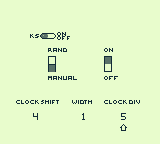

<h2 align="center">Merzboy</h2>

<p align="center">
  
</p>

Noise application for Game Boys.

## About

An application written in RGBDS assembly intended as a source of noise in a noise music setup. Rich with comments for learning purposes both for the author and hopefully the reader. Also versioned for every new iteration so you can follow code changes as the project evolves. From humble beginnings and onwards.

## Usage

| Button      | Function                                                                 |
|-------------|--------------------------------------------------------------------------|
| **A**       | Toggles on/off                                                           |
| **B**       | Toggles random or manual mode                                            |
| **Select**  | Toggles between Kill Switch or On/Off mode                               |
| **Right/Left** | Selects which part of the "Channel 4 frequency & randomness" is changed |
| **Up/Down** | Increases or decreases the selected part                        |


There are two modes of operation in Merzboy. The On/Off mode makes a sound when you press and hold the A button. In Kill Switch mode you press a once and let go, a continuous sound is played. If you then press A the sound stops, let go and it starts again.

If you want to read up on what the "clock shift", "width" and "clock div" values mean then look here https://gbdev.io/pandocs/Audio_Registers.html#ff22--nr43-channel-4-frequency--randomness

## RGBDS Tutorial
This is not intended as a classic from scratch tutorial in assembly language. Though it might come in handy to look at after working through one beginner tutorial like after finishing https://gbdev.io/gb-asm-tutorial/index.html Part 1. You have set up a development environment and tools and written a few lines. After finishing that you can start looking at version 1 in the "versions" folder. The first version is just one file with 280ish lines of code and a simple Makefile.

## Build

To build the ROM you need [RGBDS](https://github.com/gbdev/rgbds).
```bash
make
```
This will produce merzboy.gb which you can run on a Game Boy emulator or flash to a cartridge.